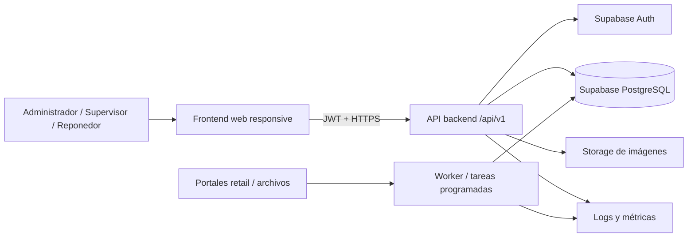

# Hito 3 — Propuestas de arquitectura y stack

Fecha: 22 de agosto de 2026.

## 1. Condicionantes reales

- 150 usuarios actuales, ~25 diarios y objetivo inicial de 1.000.
- PostgreSQL/Supabase ya contiene los datos normalizados.
- Aplicación multi-tenant con aislamiento crítico.
- Usuarios operativos, incluido público de mayor edad: UX simple, legible y táctil.
- Fotografías de catálogo y terreno.
- Carga diaria desde cuatro portales, actualmente manual.
- Equipo de desarrollo pequeño; conviene un monolito modular, no microservicios.
- Docker e independencia razonable del proveedor.
- Backend obligatorio para reglas críticas.
- El frontend legacy completo no está disponible todavía.

## 2. Arquitectura lógica común



El frontend nunca recibe `service_role`. Toda operación sensible pasa por la API. PostgreSQL sigue siendo la fuente de verdad. Las tareas programadas pueden comenzar en el mismo repositorio/imagen del backend ejecutadas como proceso separado.

## 3. Opciones de stack

### Opción A — TypeScript completo

- **Backend:** Node.js LTS + NestJS, REST versionada, OpenAPI.
- **Frontend:** React + Vite + TypeScript, TanStack Query y componentes accesibles.
- **Datos:** PostgreSQL; SQL/migraciones explícitas con una capa tipada ligera.
- **Auth:** Supabase Auth; JWT verificado en backend.
- **Storage:** Supabase Storage inicialmente.
- **Testing:** Vitest/Jest, Supertest, Playwright.
- **Docker:** imágenes Node multi-stage separadas para frontend y backend.

Ventaja principal: un solo lenguaje, contratos tipados y estructura modular clara. NestJS agrega convenciones útiles para un sistema con varios módulos y permisos.

### Opción B — Python backend + TypeScript frontend

- **Backend:** Python 3.13 + FastAPI + Pydantic, REST/OpenAPI.
- **Frontend:** React + Vite + TypeScript.
- **Datos:** SQLAlchemy 2 + Alembic o SQL explícito donde convenga.
- **Auth/Storage:** Supabase.
- **Testing:** Pytest, HTTPX, Vitest y Playwright.
- **Docker:** Python slim + build estático del frontend.

Ventaja principal: excelente para ETL, homologación y futuras automatizaciones de datos. El costo es mantener dos ecosistemas y compartir contratos mediante OpenAPI generado.

### Opción C — .NET backend + TypeScript frontend

- **Backend:** ASP.NET Core Web API, OpenAPI.
- **Frontend:** React + Vite + TypeScript.
- **Datos:** Npgsql + Dapper o EF Core.
- **Auth/Storage:** Supabase con validación JWT.
- **Testing:** xUnit, integración con Testcontainers, Vitest y Playwright.
- **Docker:** runtime ASP.NET slim + frontend estático.

Ventaja principal: backend robusto, gran rendimiento y herramientas maduras. Su costo es mayor curva/ceremonia para un proyecto pequeño si el mantenedor no domina .NET.

## 4. Comparación

| Stack | Ventajas | Desventajas | Complejidad | Escalabilidad | Mantenibilidad |
|---|---|---|---|---|---|
| A. NestJS + React | Un lenguaje; DTO tipados; módulos, guards y OpenAPI maduros; amplia disponibilidad de desarrolladores | NestJS tiene más estructura y consumo que Fastify puro | Media | Alta para el volumen previsto | Alta |
| B. FastAPI + React | Muy productivo; excelente para ETL; validación y OpenAPI simples | Dos lenguajes; sincronización de tipos; más piezas | Media | Alta | Alta si el equipo domina Python |
| C. ASP.NET + React | Rendimiento, tooling, DI y pruebas muy sólidos | Mayor curva y peso conceptual para equipo pequeño | Media-alta | Muy alta | Alta con experiencia .NET |

## 5. Recomendación

Se recomienda **Opción A: TypeScript + NestJS + React/Vite** como punto de partida.

Razones:

1. Reduce el costo cognitivo usando TypeScript en frontend y backend.
2. NestJS aporta módulos, guards, validación, inyección de dependencias y documentación OpenAPI sin diseñar un framework propio.
3. React/Vite permite una SPA portable, desplegable como archivos estáticos y sin dependencia obligatoria de Vercel.
4. El volumen no requiere SSR ni microservicios.
5. Un monorepo puede compartir tipos generados desde OpenAPI, configuración y reglas de calidad.
6. Docker puede ejecutar frontend, API y worker en cualquier host compatible.

La Opción B es preferible si la automatización/homologación de datos se convierte en el trabajo dominante o si el equipo tiene mayor experiencia Python.

## 6. Monolito modular propuesto

Módulos conceptuales del backend:

- `auth`
- `tenants`
- `users`
- `stores`
- `products`
- `stocks`
- `inventory`
- `photos`
- `statistics`
- `imports`
- `audit`
- `health`

Cada módulo separa controlador, casos de uso, acceso a datos y contratos. Esto no implica Clean Architecture ceremonial en cada archivo; las capas deben existir solo donde protejan reglas o faciliten pruebas.

## 7. Estrategia de autenticación propuesta

### Alternativa recomendada para piloto

- Supabase Auth como emisor de identidades/JWT.
- Vincular `usuario.auth_user_id` con `auth.users.id`.
- Mantener RUT como identificador laboral visible, no como secreto.
- Acceso inicial mediante **RUT + contraseña**, resuelto por backend hacia una identidad interna de Supabase.
- Forzar cambio de contraseña inicial y ofrecer recuperación administrada hasta contar con emails/teléfonos confiables.

### Alternativas

- **Teléfono + OTP:** buena UX sin contraseña, pero depende de teléfonos válidos y tiene costo por SMS.
- **Email + contraseña/magic link:** estándar, pero el origen no garantiza emails.
- **Auth propia con Argon2:** evita adaptación de Supabase Auth, pero obliga a mantener credenciales, sesiones, recuperación y mayor superficie de seguridad.

No se debe activar ninguna estrategia sin confirmar qué datos de contacto reales existen y cómo se hará el alta inicial.

## 8. Autorización y multi-tenant

- El backend obtiene usuario, tenant y rol desde el JWT y la base; nunca desde el body.
- Guards/policies por permiso, no solamente por nombre de rol.
- Toda consulta operativa incluye tenant explícito o se ejecuta bajo RLS corregido.
- Para operaciones críticas se valida coherencia entre tenant, usuario, producto y local.
- Administrador no implica administración global de la plataforma.
- Deben existir pruebas negativas: usuario A no puede leer, inferir ni modificar tenant B.

Matriz inicial propuesta:

| Capacidad | Admin | Supervisor | Reponedor | Rep. externo |
|---|---:|---:|---:|---:|
| Ver locales/productos asignados | Sí | Sí | Sí | Sí |
| Registrar inventario/foto | Sí | Sí | Sí | Sí |
| Ver historial operativo | Sí | Sí | Según asignación | Según asignación |
| Administrar usuarios | Sí | No | No | No |
| Editar precio/producto | Sí | Sí | No | No |
| Ver estadísticas globales tenant | Sí | Por confirmar | No | No |

Requiere validación del cliente.

## 9. Estrategia de API

- REST JSON versionada bajo `/api/v1`.
- OpenAPI generado desde el backend.
- Paginación por cursor cuando el orden sea estable; offset para catálogos pequeños.
- Filtros explícitos y selección de columnas; evitar descargar tablas completas.
- Idempotency key para importaciones y escrituras susceptibles de reintento.
- Errores con código estable, mensaje seguro y `requestId`.

Recursos iniciales:

```text
/api/v1/auth
/api/v1/users
/api/v1/stores
/api/v1/products
/api/v1/stocks
/api/v1/inventory
/api/v1/photos
/api/v1/statistics
/api/v1/imports
```

## 10. Estrategia de fotografías

Se recomienda **Supabase Storage** inicialmente porque ya es dependencia intencional, integra políticas y reduce operación.

- Buckets privados separados: `product-images` y `field-photos`.
- Objetos: `<tenant>/<tipo>/<yyyy>/<mm>/<uuid>.<ext>`.
- MIME permitidos: JPEG, PNG y WebP; considerar HEIC solo con conversión controlada.
- Tamaño inicial sugerido: máximo 8 MB antes de procesamiento.
- Validar contenido real, no solo extensión/MIME enviado.
- Generar miniaturas/compresión fuera de PostgreSQL.
- URLs firmadas de corta duración.
- Retención de fotos de terreno pendiente de aprobación.

Alternativa futura: storage S3-compatible. La base debe almacenar referencias lógicas/URLs, no Base64.

## 11. Estrategia Docker

Servicios de desarrollo propuestos:

```text
frontend  -> servidor de desarrollo o Nginx en build productivo
backend   -> API stateless
worker    -> misma imagen backend, comando diferente
```

Supabase permanece remoto. Los Dockerfiles usarán multi-stage, usuarios no root, healthchecks y configuración por variables. `docker compose up` debe levantar el entorno local sin secretos reales.

No se incorpora Redis hasta demostrar una necesidad de caché/cola. Las tareas iniciales pueden ejecutarse con scheduler del proveedor, cron container o mecanismo portable equivalente, documentando diferencias.

## 12. Estrategia Git/GitHub

- `main`: versiones estables.
- `develop`: integración.
- `feature/*`: funcionalidades.
- `fix/*`: correcciones.
- Pull requests con revisión y CI obligatorio.
- Commits pequeños y convencionales (`feat`, `fix`, `docs`, `test`, `chore`).
- Tags semánticos y releases documentadas.
- Protección de `main` y `develop`.
- Nunca versionar credenciales, Excel, CSV de migración, dumps ni fotos reales.

CI inicial:

1. lint y formato;
2. unit tests;
3. integration/API tests;
4. build frontend/backend;
5. build de imágenes Docker;
6. escaneo básico de dependencias y secretos.

No habrá despliegue automático a producción hasta aprobar ambientes, respaldo, rollback y responsables.

## 13. Estrategia de seguridad

- Secretos solo en backend/secret manager; rotar las credenciales usadas durante la migración antes de producción.
- JWT validado por issuer, audience, firma y expiración.
- RLS corregido y probado como defensa adicional.
- CORS por allowlist; CSRF según transporte de tokens/cookies.
- Rate limiting en login, búsquedas costosas y uploads.
- DTO validation estricta y queries parametrizadas.
- Headers de seguridad y CSP en frontend.
- Logs JSON con request ID, tenant y usuario; sin tokens, RUT completo innecesario ni claves.
- Límites y validación de archivos.
- Auditoría de operaciones administrativas.
- Backups y pruebas de restauración.

## 14. Decisiones pendientes de aprobación

1. Stack recomendado A o alternativa B/C.
2. Método de autenticación inicial.
3. Matriz exacta de permisos.
4. Supabase Storage como destino de imágenes.
5. Política de retención.
6. Alcance de automatización de portales.
7. Inclusión o exclusión definitiva del módulo de honorarios.

## 15. Punto de detención

Conforme a las instrucciones, aquí termina el Hito 3. No se creará la estructura del nuevo repositorio ni se implementará código hasta recibir aprobación explícita de stack, autenticación y alcance inicial.
